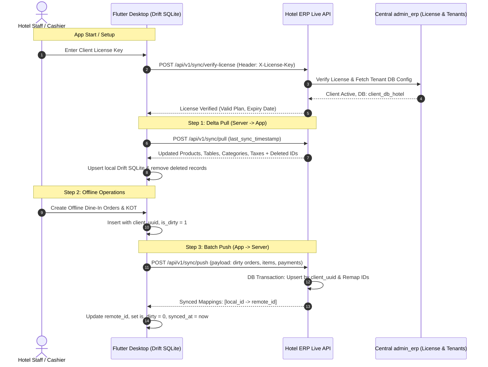

# Flutter Desktop Drift Database & Live API Sync Guide

> **Project:** Hotel ERP (hotel-erp-admin-product)  
> **Target App:** Flutter Desktop (Windows / macOS / Linux)  
> **Local DB:** Drift (SQLite)  
> **Live Backend:** Laravel Multi-Tenant ERP with `admin_erp` License Key  
> **Generated:** October 2026  

---

## Table of Contents
1. [Overview & Architecture](#1-overview--architecture)
2. [Client License Key Authentication](#2-client-license-key-authentication)
3. [Sync Mechanism: Two-Way Delta Sync](#3-sync-mechanism-two-way-delta-sync)
4. [Complete Drift Database Schema (Dart)](#4-complete-drift-database-schema-dart)
5. [Sync API Specifications](#5-sync-api-specifications)
   - [5.1. Verify License](#51-verify-license)
   - [5.2. Login](#52-login)
   - [5.3. Delta Pull (Server -> Desktop)](#53-delta-pull-server---desktop)
   - [5.4. Batch Push (Desktop -> Server)](#54-batch-push-desktop---server)
   - [5.5. Upload Image](#55-upload-image)
6. [Flutter Dart Implementation Examples](#6-flutter-dart-implementation-examples)
   - [6.1. Sync Service Workflow](#61-sync-service-workflow)
   - [6.2. Foreign Key Conflict Resolution with UUIDs](#62-foreign-key-conflict-resolution-with-uuids)

---

## 1. Overview & Architecture

When running offline in a Hotel or Restaurant environment, POS billing and table ordering cannot stop if the internet goes down. 
The Flutter Desktop app writes all transactions to a local SQLite database using **Drift**. When an internet connection is available, the app synchronizes changes with the live Laravel ERP database.



---

## 2. Client License Key Authentication

Each client has a unique **License Key** (stored as `unique_id` in `admin_erp`).
- In every sync request, the Flutter app **MUST** provide this key in the HTTP Header:
  ```http
  X-License-Key: ABC12
  ```
  *(Or in JSON body: `"license_key": "ABC12"`)*

When received:
1. `hotel-erp-admin-product` verifies the license with `admin_erp`.
2. Resolves the client's dedicated database connection.
3. If active and within subscription period, the request is executed directly against the client's live database.
4. If expired or invalid, returns `HTTP 403 Forbidden` with a detailed error.

---

## 3. Sync Mechanism: Two-Way Delta Sync

### Essential Sync Columns on Drift Tables
Every table in the local Drift SQLite database must contain:
| Column | Type | Purpose |
|---|---|---|
| `local_id` | `Int` (AutoIncrement, Primary Key) | Local SQLite unique ID |
| `remote_id` | `Int` (Nullable, Indexed) | Remote MySQL `id` on live server |
| `client_uuid` | `Text` (Unique, 36/100 chars) | Global UUID (`uuid.v4()`) created at record creation |
| `is_dirty` | `Bool` (Default `false`) | `true` if record was created/modified offline and needs push |
| `is_deleted` | `Bool` (Default `false`) | `true` if record was deleted offline |
| `synced_at` | `DateTime` (Nullable) | Last successful sync timestamp |
| `updated_at` | `DateTime` | Timestamp of last edit |

---

## 4. Complete Drift Database Schema (Dart)

Save this in your Flutter project under `lib/data/database/tables.dart` and `lib/data/database/app_database.dart`:

```dart
import 'package:drift/drift.dart';

// Mixin for standard sync fields
mixin SyncColumns on Table {
  IntColumn get localId => integer().autoIncrement()();
  IntColumn get remoteId => integer().nullable()();
  TextColumn get clientUuid => text().withLength(min: 36, max: 100)();
  BoolColumn get isDirty => boolean().withDefault(const Constant(false))();
  BoolColumn get isDeleted => boolean().withDefault(const Constant(false))();
  DateTimeColumn get syncedAt => dateTime().nullable()();
  DateTimeColumn get createdAt => dateTime().withDefault(currentDateAndTime)();
  DateTimeColumn get updatedAt => dateTime().withDefault(currentDateAndTime)();
}

// 1. Categories
class CategoriesTable extends Table with SyncColumns {
  TextColumn get name => text().withLength(min: 1, max: 150)();
  TextColumn get image => text().nullable()();
  IntColumn get branchId => integer().nullable()();
}

// 2. Brands
class BrandsTable extends Table with SyncColumns {
  TextColumn get name => text().withLength(min: 1, max: 150)();
  TextColumn get logo => text().nullable()();
  IntColumn get branchId => integer().nullable()();
}

// 3. Units / Quantity Types
class QuantityTypesTable extends Table with SyncColumns {
  TextColumn get type => text().withLength(min: 1, max: 50)();
  IntColumn get branchId => integer().nullable()();
}

// 4. Products / Menu Items
class ProductsTable extends Table with SyncColumns {
  TextColumn get name => text().withLength(min: 1, max: 200)();
  TextColumn get sku => text().nullable()();
  TextColumn get barcode => text().nullable()();
  TextColumn get description => text().nullable()();
  RealColumn get price => real().withDefault(const Constant(0.0))();
  RealColumn get quantity => real().withDefault(const Constant(0.0))();
  TextColumn get status => text().withDefault(const Constant('active'))();
  TextColumn get availablility => text().withDefault(const Constant('in_stock'))();
  TextColumn get images => text().nullable()(); // JSON string
  
  // Foreign Keys (Remote & Local UUID)
  IntColumn get categoryId => integer().nullable()();
  TextColumn get categoryClientUuid => text().nullable()();
  
  IntColumn get brandId => integer().nullable()();
  TextColumn get brandClientUuid => text().nullable()();
  
  IntColumn get quantityTypeId => integer().nullable()();
  TextColumn get quantityTypeClientUuid => text().nullable()();
  
  IntColumn get branchId => integer().nullable()();
}

// 5. Hotel / Restaurant Tables (table_no)
class TableNoTable extends Table with SyncColumns {
  TextColumn get tableName => text().withLength(min: 1, max: 100)();
  TextColumn get tableType => text().nullable().withDefault(const Constant('Dine-In'))();
  IntColumn get tableStatus => integer().withDefault(const Constant(0))(); // 0: Blank, 1: Running, 2: Reserved
  TextColumn get status => text().withDefault(const Constant('blank'))();
  IntColumn get orderId => integer().nullable()();
  TextColumn get orderClientUuid => text().nullable()();
  IntColumn get branchId => integer().nullable()();
}

// 6. Table Reservations
class TableReservationsTable extends Table with SyncColumns {
  IntColumn get tableId => integer().nullable()();
  TextColumn get tableClientUuid => text().nullable()();
  TextColumn get customerName => text().withLength(min: 1, max: 150)();
  TextColumn get customerPhone => text().nullable()();
  DateTimeColumn get reservationDate => dateTime()();
  TextColumn get reservationTime => text()();
  IntColumn get guests => integer().withDefault(const Constant(2))();
  TextColumn get status => text().withDefault(const Constant('pending'))(); // pending, confirmed, cancelled
  TextColumn get notes => text().nullable()();
  IntColumn get branchId => integer().nullable()();
}

// 7. Customers / Users
class UsersTable extends Table with SyncColumns {
  TextColumn get name => text().withLength(min: 1, max: 150)();
  TextColumn get email => text().nullable()();
  TextColumn get phone => text().nullable()();
  TextColumn get role => text().withDefault(const Constant('customer'))(); // customer, waiter, cashier
  IntColumn get branchId => integer().nullable()();
}

// 8. Orders (POS & Dining)
class OrdersTable extends Table with SyncColumns {
  TextColumn get orderNumber => text().nullable()();
  IntColumn get userId => integer().nullable()();
  TextColumn get userClientUuid => text().nullable()();
  TextColumn get customerName => text().nullable()();
  TextColumn get customerPhone => text().nullable()();
  TextColumn get tableNo => text().nullable()();
  TextColumn get orderType => text().withDefault(const Constant('Dine-In'))(); // Dine-In, Takeaway, Delivery
  TextColumn get type => text().withDefault(const Constant('POS'))();
  RealColumn get discount => real().withDefault(const Constant(0.0))();
  RealColumn get totalAmount => real().withDefault(const Constant(0.0))();
  RealColumn get remainingAmount => real().withDefault(const Constant(0.0))();
  TextColumn get paymentStatus => text().withDefault(const Constant('completed'))();
  TextColumn get paymentMethod => text().withDefault(const Constant('cash'))(); // cash, upi, card, split
  TextColumn get deliveryStatus => text().nullable()();
  IntColumn get branchId => integer().nullable()();
}

// 9. Order Items
class OrderItemsTable extends Table with SyncColumns {
  IntColumn get orderId => integer().nullable()();
  TextColumn get orderClientUuid => text()();
  IntColumn get productId => integer().nullable()();
  TextColumn get productClientUuid => text().nullable()();
  RealColumn get quantity => real().withDefault(const Constant(1.0))();
  RealColumn get price => real().withDefault(const Constant(0.0))();
  RealColumn get totalAmount => real().withDefault(const Constant(0.0))();
  IntColumn get categoryId => integer().nullable()();
  IntColumn get quantityTypeId => integer().nullable()();
  IntColumn get branchId => integer().nullable()();
}

// 10. Payment Store
class PaymentStoreTable extends Table with SyncColumns {
  IntColumn get orderId => integer().nullable()();
  TextColumn get orderClientUuid => text().nullable()();
  RealColumn get amount => real().withDefault(const Constant(0.0))();
  TextColumn get paymentMethod => text().withDefault(const Constant('cash'))();
  TextColumn get status => text().withDefault(const Constant('completed'))();
  IntColumn get branchId => integer().nullable()();
}

// 11. Expenses
class ExpensesTable extends Table with SyncColumns {
  IntColumn get expenseTypeId => integer().withDefault(const Constant(1))();
  TextColumn get expenseName => text().withLength(min: 1, max: 200)();
  RealColumn get amount => real().withDefault(const Constant(0.0))();
  DateTimeColumn get expenseDate => dateTime()();
  TextColumn get note => text().nullable()();
  IntColumn get branchId => integer().nullable()();
}

// 12. Sync Metadata (Key-Value for last sync timestamp)
class SyncMetaTable extends Table {
  TextColumn get metaKey => text().withLength(min: 1, max: 100)();
  TextColumn get metaValue => text()();
  DateTimeColumn get updatedAt => dateTime().withDefault(currentDateAndTime)();

  @override
  Set<Column> get primaryKey => {metaKey};
}
```

---

## 5. Sync API Specifications

### Base URLs
- **Local Dev:** `http://127.0.0.1:8001/api/v1/sync`
- **Live Server:** `https://your-hotel-domain.com/api/v1/sync`

---

### 5.1. Verify License
Checks if the client license key is active, valid, and within subscription dates.

- **Method:** `POST`
- **Endpoint:** `/api/v1/sync/verify-license`
- **Headers:**
  ```http
  Content-Type: application/json
  X-License-Key: 23B8A
  ```
- **Request Body:**
  ```json
  {
    "license_key": "23B8A"
  }
  ```
- **Success Response (200 OK):**
  ```json
  {
    "status": true,
    "message": "License is active and valid.",
    "client": {
      "id": 12,
      "client_name": "Royal Palace Hotel",
      "brand_name": "Royal Heritage",
      "domain": "royalpalace.fableadtech.com",
      "plan_name": "Standard",
      "status": "Active",
      "expiry_date": "2027-10-30",
      "max_user": 20,
      "max_branch": 2
    },
    "server_time": "2026-10-30 15:30:00"
  }
  ```
- **Error Response (403 Forbidden):**
  ```json
  {
    "status": false,
    "error": "EXPIRED",
    "message": "Your subscription/license has expired. Please renew."
  }
  ```

---

### 5.2. Login
Authenticates cashier or manager and returns sync token.

- **Method:** `POST`
- **Endpoint:** `/api/v1/sync/login`
- **Headers:**
  ```http
  Content-Type: application/json
  X-License-Key: 23B8A
  ```
- **Request Body:**
  ```json
  {
    "email": "cashier@hotel.com",
    "password": "secretpassword",
    "license_key": "23B8A"
  }
  ```
- **Success Response (200 OK):**
  ```json
  {
    "status": true,
    "message": "Login successful.",
    "token": "1|def50200...",
    "user": {
      "id": 4,
      "client_uuid": "3fa85f64-5717-4562-b3fc-2c963f66afa6",
      "name": "John Cashier",
      "email": "cashier@hotel.com",
      "role": "admin",
      "branch_id": 1
    },
    "server_time": "2026-10-30 15:30:00"
  }
  ```

---

### 5.3. Delta Pull (Server -> Desktop)
Pulls all created, modified, and deleted records since `last_sync_timestamp`.

- **Method:** `POST`
- **Endpoint:** `/api/v1/sync/pull`
- **Headers:**
  ```http
  Content-Type: application/json
  Authorization: Bearer <TOKEN>
  X-License-Key: 23B8A
  ```
- **Request Body:**
  ```json
  {
    "license_key": "23B8A",
    "branch_id": 1,
    "last_sync_timestamp": "2026-10-30 14:00:00"
  }
  ```
  *(Note: If `last_sync_timestamp` is null or empty, it performs a Full Pull).*

- **Success Response (200 OK):**
  ```json
  {
    "status": "success",
    "server_time": "2026-10-30 15:35:00",
    "data": {
      "categories": [
        {
          "id": 1,
          "client_uuid": "c56a4180-65aa-42ec-a945-5fd21dec0538",
          "name": "Starters & Soups",
          "image": "img/category/soup.png",
          "branch_id": 1,
          "updated_at": "2026-10-30 15:10:00"
        }
      ],
      "products": [
        {
          "id": 10,
          "client_uuid": "8e367873-cbf2-4112-9c3f-c309f485bb2e",
          "name": "Paneer Butter Masala",
          "price": 280.00,
          "quantity": 100.0,
          "category_id": 1,
          "status": "active",
          "availablility": "in_stock",
          "updated_at": "2026-10-30 15:12:00"
        }
      ],
      "table_no": [
        {
          "id": 3,
          "client_uuid": "fb77299d-1510-449e-8fa9-b8db2cbe81dc",
          "table_name": "Table T-3",
          "table_type": "Dine-In",
          "table_status": 0,
          "status": "blank",
          "order_id": null
        }
      ],
      "orders": [],
      "deleted_ids": {
        "products": [5],
        "categories": []
      },
      "deleted_records": {
        "products": [
          {
            "remote_id": 5,
            "client_uuid": "11111111-2222-3333-4444-555555555555"
          }
        ]
      }
    }
  }
  ```

---

### 5.4. Batch Push (Desktop -> Server)
Pushes offline records created or modified locally in Drift.

- **Method:** `POST`
- **Endpoint:** `/api/v1/sync/push`
- **Headers:**
  ```http
  Content-Type: application/json
  Authorization: Bearer <TOKEN>
  X-License-Key: 23B8A
  ```
- **Request Body:**
  ```json
  {
    "license_key": "23B8A",
    "branch_id": 1,
    "payload": {
      "users": [
        {
          "local_id": 101,
          "client_uuid": "a739281e-1234-4a2b-9876-000000000001",
          "name": "Ramesh Patel",
          "phone": "9876543210",
          "role": "customer"
        }
      ],
      "orders": [
        {
          "local_id": 501,
          "client_uuid": "b839281e-2234-4a2b-9876-000000000002",
          "order_number": "ORD-20261030-001",
          "user_client_uuid": "a739281e-1234-4a2b-9876-000000000001",
          "table_no": "Table T-3",
          "order_type": "Dine-In",
          "total_amount": 560.00,
          "remaining_amount": 0.00,
          "payment_status": "completed",
          "payment_method": "cash",
          "created_at": "2026-10-30 14:45:00",
          "items": [
            {
              "local_id": 1001,
              "client_uuid": "c939281e-3234-4a2b-9876-000000000003",
              "product_client_uuid": "8e367873-cbf2-4112-9c3f-c309f485bb2e",
              "quantity": 2,
              "price": 280.00,
              "total_amount": 560.00
            }
          ]
        }
      ],
      "payment_store": [
        {
          "local_id": 201,
          "client_uuid": "d039281e-4234-4a2b-9876-000000000004",
          "order_client_uuid": "b839281e-2234-4a2b-9876-000000000002",
          "amount": 560.00,
          "payment_method": "cash",
          "status": "completed"
        }
      ],
      "deleted_records": {
        "orders": []
      }
    }
  }
  ```

- **Success Response (200 OK):**
  ```json
  {
    "status": "success",
    "message": "Data synchronized successfully.",
    "server_time": "2026-10-30 15:36:10",
    "synced_mappings": {
      "users": [
        {
          "local_id": 101,
          "remote_id": 48,
          "client_uuid": "a739281e-1234-4a2b-9876-000000000001"
        }
      ],
      "orders": [
        {
          "local_id": 501,
          "remote_id": 125,
          "client_uuid": "b839281e-2234-4a2b-9876-000000000002",
          "items": [
            {
              "local_id": 1001,
              "remote_id": 310,
              "client_uuid": "c939281e-3234-4a2b-9876-000000000003"
            }
          ]
        }
      ],
      "payment_store": [
        {
          "local_id": 201,
          "remote_id": 92,
          "client_uuid": "d039281e-4234-4a2b-9876-000000000004"
        }
      ]
    }
  }
  ```

---

### 5.5. Upload Image
Uploads images captured offline (e.g., photos of receipts, product images).

- **Method:** `POST`
- **Endpoint:** `/api/v1/sync/upload-image`
- **Headers:**
  ```http
  Authorization: Bearer <TOKEN>
  X-License-Key: 23B8A
  ```
- **Body:** `multipart/form-data` with field `image`
- **Response:**
  ```json
  {
    "status": "success",
    "path": "img/product/abc12345.jpg",
    "url": "https://your-hotel-domain.com/storage/img/product/abc12345.jpg"
  }
  ```

---

## 6. Flutter Dart Implementation Examples

### 6.1. Sync Service Workflow

Here is how the sync loop should be structured in Dart:

```dart
import 'dart:convert';
import 'package:http/http.dart' as http;
import 'package:uuid/uuid.dart';

class HotelSyncService {
  final String baseUrl;
  final String licenseKey;
  String? authToken;

  HotelSyncService({
    required this.baseUrl,
    required this.licenseKey,
    this.authToken,
  });

  Map<String, String> get _headers => {
    'Content-Type': 'application/json',
    'Accept': 'application/json',
    'X-License-Key': licenseKey,
    if (authToken != null) 'Authorization': 'Bearer $authToken',
  };

  /// Step 1: Delta Pull
  Future<void> syncPull(AppDatabase db) async {
    // 1. Get last sync timestamp from local SQLite
    final lastSyncMeta = await (db.select(db.syncMetaTable)
      ..where((t) => t.metaKey.equals('last_sync_timestamp'))).getSingleOrNull();

    final lastSyncTimestamp = lastSyncMeta?.metaValue;

    // 2. Request delta data from server
    final response = await http.post(
      Uri.parse('$baseUrl/pull'),
      headers: _headers,
      body: jsonEncode({
        'license_key': licenseKey,
        'branch_id': 1,
        'last_sync_timestamp': lastSyncTimestamp,
      }),
    );

    if (response.statusCode == 200) {
      final json = jsonDecode(response.body);
      final serverTime = json['server_time'] as String;
      final data = json['data'] as Map<String, dynamic>;

      await db.transaction(() async {
        // Upsert categories
        if (data['categories'] != null) {
          for (var item in data['categories']) {
            await db.into(db.categoriesTable).insertOnConflictUpdate(
              CategoriesTableCompanion.insert(
                remoteId: Value(item['id']),
                clientUuid: item['client_uuid'],
                name: item['name'],
                image: Value(item['image']),
                isDirty: const Value(false),
                syncedAt: Value(DateTime.parse(serverTime)),
              ),
            );
          }
        }

        // Upsert products
        if (data['products'] != null) {
          for (var item in data['products']) {
            await db.into(db.productsTable).insertOnConflictUpdate(
              ProductsTableCompanion.insert(
                remoteId: Value(item['id']),
                clientUuid: item['client_uuid'],
                name: item['name'],
                price: Value((item['price'] as num).toDouble()),
                quantity: Value((item['quantity'] as num).toDouble()),
                categoryId: Value(item['category_id']),
                status: Value(item['status'] ?? 'active'),
                availablility: Value(item['availablility'] ?? 'in_stock'),
                isDirty: const Value(false),
                syncedAt: Value(DateTime.parse(serverTime)),
              ),
            );
          }
        }

        // Handle soft deleted IDs
        final deletedIds = data['deleted_ids'] as Map<String, dynamic>?;
        if (deletedIds?['products'] != null) {
          final List prodIds = deletedIds!['products'];
          await (db.delete(db.productsTable)..where((t) => t.remoteId.isIn(prodIds.cast<int>()))).go();
        }

        // Save new last_sync_timestamp
        await db.into(db.syncMetaTable).insertOnConflictUpdate(
          SyncMetaTableCompanion.insert(
            metaKey: 'last_sync_timestamp',
            metaValue: serverTime,
            updatedAt: Value(DateTime.now()),
          ),
        );
      });
    }
  }

  /// Step 2: Batch Push
  Future<void> syncPush(AppDatabase db) async {
    // 1. Fetch all dirty records (isDirty == true)
    final dirtyOrders = await (db.select(db.ordersTable)..where((t) => t.isDirty.equals(true))).get();
    if (dirtyOrders.isEmpty) return;

    List<Map<String, dynamic>> orderPayloads = [];

    for (var order in dirtyOrders) {
      final items = await (db.select(db.orderItemsTable)
        ..where((t) => t.orderClientUuid.equals(order.clientUuid))).get();

      orderPayloads.add({
        'local_id': order.localId,
        'client_uuid': order.clientUuid,
        'order_number': order.orderNumber,
        'user_client_uuid': order.userClientUuid,
        'table_no': order.tableNo,
        'order_type': order.orderType,
        'total_amount': order.totalAmount,
        'remaining_amount': order.remainingAmount,
        'payment_status': order.paymentStatus,
        'payment_method': order.paymentMethod,
        'created_at': order.createdAt.toIso8601String(),
        'items': items.map((it) => {
          'local_id': it.localId,
          'client_uuid': it.clientUuid,
          'product_client_uuid': it.productClientUuid,
          'quantity': it.quantity,
          'price': it.price,
          'total_amount': it.totalAmount,
        }).toList(),
      });
    }

    // 2. Send batch to API
    final response = await http.post(
      Uri.parse('$baseUrl/push'),
      headers: _headers,
      body: jsonEncode({
        'license_key': licenseKey,
        'branch_id': 1,
        'payload': {
          'orders': orderPayloads,
        },
      }),
    );

    if (response.statusCode == 200) {
      final json = jsonDecode(response.body);
      final mappings = json['synced_mappings']?['orders'] as List? ?? [];

      // 3. Update local SQLite: mark clean and set remote_id
      await db.transaction(() async {
        for (var m in mappings) {
          final localId = m['local_id'] as int;
          final remoteId = m['remote_id'] as int;

          await (db.update(db.ordersTable)..where((t) => t.localId.equals(localId))).write(
            OrdersTableCompanion(
              remoteId: Value(remoteId),
              isDirty: const Value(false),
              syncedAt: Value(DateTime.now()),
            ),
          );

          // Update child items
          final itemMappings = m['items'] as List? ?? [];
          for (var im in itemMappings) {
            await (db.update(db.orderItemsTable)..where((t) => t.localId.equals(im['local_id']))).write(
              OrderItemsTableCompanion(
                remoteId: Value(im['remote_id']),
                isDirty: const Value(false),
                syncedAt: Value(DateTime.now()),
              ),
            );
          }
        }
      });
    }
  }
}
```

---

### 6.2. Foreign Key Conflict Resolution with UUIDs

When creating records offline, traditional integer auto-increment IDs cause primary key collisions when merged with a central database.

#### The UUID Solution:
1. When creating a new Order or Customer in the Flutter app:
   ```dart
   final newCustomerUuid = const Uuid().v4();
   final newOrderUuid = const Uuid().v4();
   ```
2. The Order references `user_client_uuid = newCustomerUuid`.
3. The OrderItem references `order_client_uuid = newOrderUuid`.
4. When synced to Laravel:
   - The Laravel `SyncController` creates the User first, inserts it with `client_uuid`.
   - When creating the Order, it looks up `User::where('client_uuid', $order['user_client_uuid'])->first()`, maps the foreign key `user_id = $user->id`, and saves.
   - It returns the `synced_mappings` array to the desktop app.
   - The desktop app matches by `local_id` / `client_uuid` and updates `remote_id` without breaking any relational integrity.

---

## 7. Summary Checklist for App Developers

- [ ] Add `drift`, `sqlite3_flutter_libs`, `uuid`, and `http` to `pubspec.yaml`.
- [ ] On app first launch, prompt for **Client License Key** and verify via `/api/v1/sync/verify-license`.
- [ ] Include header `X-License-Key` on **EVERY** HTTP request.
- [ ] Run `syncPull` at app start to download the latest menu, tables, and tax rates.
- [ ] Set up a timer (e.g. every 60 seconds) or a connectivity listener (`connectivity_plus`) to trigger `syncPush` followed by `syncPull`.
- [ ] When cashier creates orders offline, set `is_dirty = true` and `client_uuid = Uuid().v4()`.
- [ ] When server responds with `synced_mappings`, update `remote_id` and set `is_dirty = false`.
